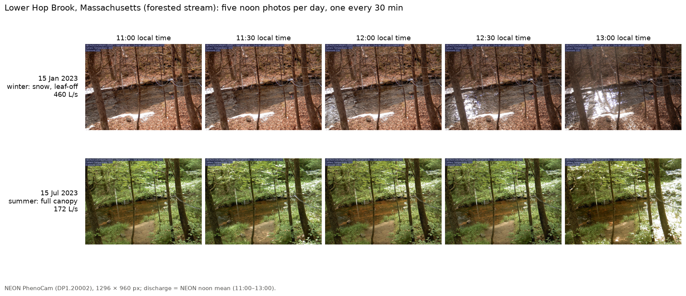
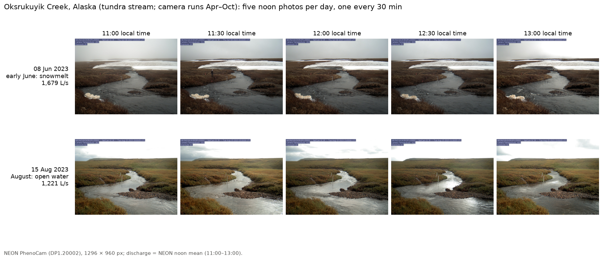
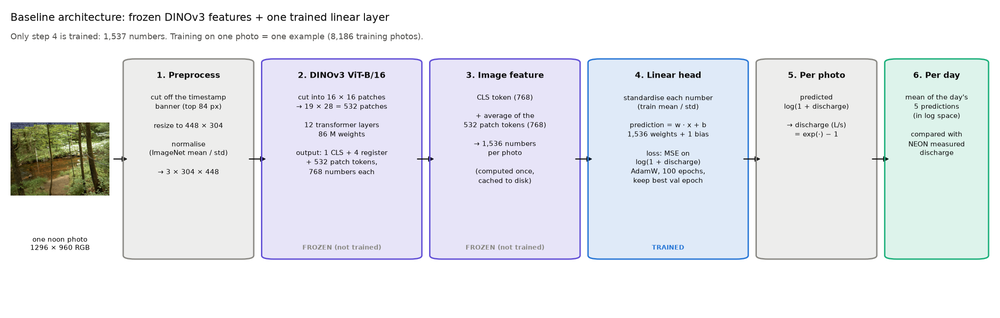
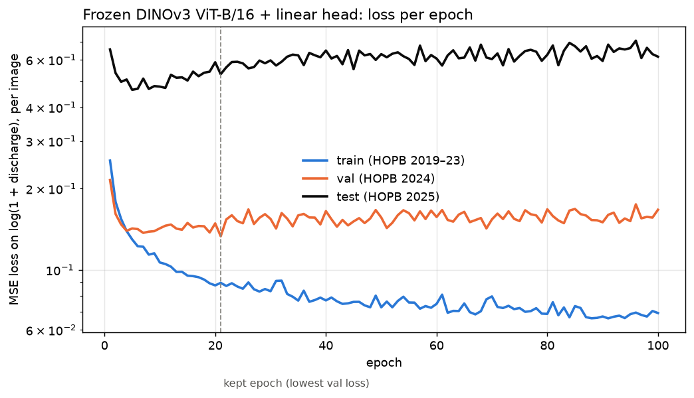
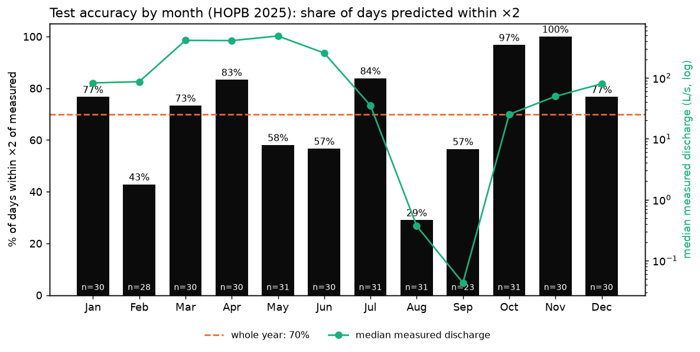
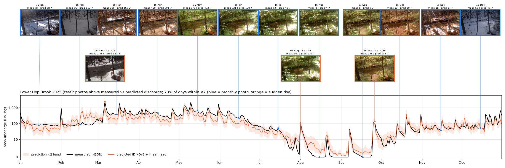

# River PhenoCam discharge: predicting stream flow from camera images

NEON cameras photograph two streams every 30 minutes, and NEON measures how much water flows past (**discharge**,
litres per second). We pair each noon photo with the discharge at that moment. The question: **can a model read the
flow from the picture?**

This tutorial downloads the data, trains a simple model (frozen DINOv3 + one linear layer) and shows where it works and
where it fails. About 15 minutes of compute plus the download.

**Contents**
1. [Look at the data](#step-1-look-at-the-data)
2. [Download the images](#step-2-download-the-images)
3. [Load a split in Python](#step-3-load-a-split-in-python)
- [The baseline architecture](#the-baseline-architecture)
4. [Extract features with DINOv3](#step-4-extract-features-with-dinov3)
5. [Train the model](#step-5-train-the-model)
6. [See how well it does](#step-6-see-how-well-it-does)
7. [Metrics and figures to report](#step-7-metrics-and-figures-to-report)
8. [What to try next](#step-8-what-to-try-next)
- [Reference: the data in detail](#reference-the-data-in-detail)

---

## Step 1: Look at the data

The repository is small (~5 MB): split files only, no images.

```bash
git clone <this repository> && cd river-phenocam-discharge
```

Two streams:
- **Lower Hop Brook**, Massachusetts: forested, the training site.
- **Oksrukuyik Creek**, Alaska: open tundra, ~4× larger, used only to test transfer to a new place.

Each day has **five photos, 11:00–13:00, one every 30 minutes**:





The splits are **whole years**, so a model is always tested on a year it has never seen:

| split | stream | period | days | images | median discharge |
|---|---|---|---|---|---|
| `train` | Lower Hop Brook | Apr 2019 – Dec 2023 | 1,648 | 8,186 | 192 L/s |
| `val` | Lower Hop Brook | 2024 | 364 | 1,810 | 94 L/s |
| `test` | Lower Hop Brook | 2025 | 355 | 1,766 | 81 L/s |
| `test_oksr` | Oksrukuyik Creek | Aug 2020 – Oct 2025 (Apr–Oct) | 497 | 2,476 | 819 L/s |

Fit on `train`, choose settings on `val`, use `test` only for the final number. `test_oksr`: does a Hop Brook model
work in Alaska?

Each split is a CSV in `data/discharge/`, one row per image (shortened):

```
image_id                                   site date       time_local slot  url                          discharge_lps
NEON.D01.HOPB.DP1.20002_2025_01_01_110004  HOPB 2025-01-01 11:00:04   11:00 https://phenocam.nau.edu/...  542.25
NEON.D01.HOPB.DP1.20002_2025_01_01_113004  HOPB 2025-01-01 11:30:04   11:30 https://phenocam.nau.edu/...  526.67
```

`discharge_lps` is the label. All columns: [reference](#columns-of-the-split-files).

---

## Step 2: Download the images

`download.py` fetches the images from the public PhenoCam archive (Python 3.8+, no extra packages). Try 50 first:

```bash
python download.py --split val --limit 50
```

```
50 images from val -> data/images
  50/50  downloaded 50, already present 0, failed 0
done: all images present and verified.
```

Then everything (14,238 images, ~9 GB, about an hour):

```bash
python download.py                          # all four splits
python download.py --split train val test   # or only some
```

Images go to `data/images/<site>/<year>/<filename>` and are checksum-verified. Interrupted? Run the same command again.

---

## Step 3: Load a split in Python

```bash
pip install -r requirements.txt
python examples/load_split.py --split val
```

```
1810 images; first: 2024-01-01 11:00:06, image (3, 960, 1296), discharge 366.5 L/s (target log1p = 5.907)
```

The target is **log(1 + discharge)**: storms carry ~100× more water than dry weeks, and on a log scale an error of ×2
counts the same at 10 L/s as at 1,000 L/s. The `+1` handles zero flow.

---

## The baseline architecture

A frozen pretrained vision model, plus **one linear layer**, the only trained part.



| step | what happens | output | trained? |
|---|---|---|---|
| 1. Preprocess | cut the timestamp banner (top 84 px), resize to 448 × 304, ImageNet normalisation | 3 × 304 × 448 | – |
| 2. DINOv3 ViT-B/16 | 532 patches of 16 × 16 px through 12 transformer layers | 1 CLS + 4 register + 532 patch tokens, × 768 | no (86 M, frozen) |
| 3. Image feature | CLS token + average of the 532 patch tokens | 1,536 | no (cached once) |
| 4. Linear head | standardise, then w · x + b | 1 | **yes (1,537 numbers)** |
| 5. Per photo | output is log(1 + discharge) | 1 | – |
| 6. Per day | average the day's photo predictions (log space) | 1 per day | – |

- **Training:** one photo = one example (8,186). MSE on log(1 + discharge); AdamW, lr 0.001, weight decay 0.01,
  batch 256, 100 epochs; keep the epoch with the lowest `val` loss.
- **Per photo vs per day:** training and the loss figure are per photo; all results are per day (mean of the day's
  predictions vs mean of its labels), so every day counts once.
- **Why:** ~1,600 training days are too few to train a large model; frozen features learn only 1,537 numbers and train
  in a minute. Weakness: averaging all patches weighs trees and banks like the water (see Step 8).

---

## Step 4: Extract features with DINOv3

[DINOv3](https://huggingface.co/facebook/dinov3-vitb16-pretrain-lvd1689m) (Meta, pretrained on >1 billion images)
turns each photo into 1,536 numbers. It is gated: accept the license on Hugging Face and log in once.

```bash
huggingface-cli login
python baseline/extract_features.py
```

```
facebook/dinov3-vitb16-pretrain-lvd1689m on cuda (torch.float32)
train: (8186, 1536) in 91s
val: (1810, 1536) in 24s
test: (1766, 1536) in 20s
test_oksr: (2476, 1536) in 27s
```

Times on one V100 GPU; a CPU works but is slow. Features are saved in `baseline/features/`.

---

## Step 5: Train the model

```bash
python baseline/train_linear.py
```

```
best epoch 21 (val loss 0.133)
train      days 1648  within x2 98%  R2 0.98
val        days  364  within x2 98%  R2 0.95
test       days  355  within x2 70%  R2 0.86
test_oksr  days  497  within x2 53%  R2 0.00
```



- **Train loss** (blue) keeps falling.
- **Val loss** (orange) stops improving after ~20 epochs, so **epoch 21** is kept. Test is never used for this choice.
- **Test loss** (black) is higher: 2025 is an unusual year (drought, a tree cut down on the bank).

---

## Step 6: See how well it does

Main score: **share of days predicted within ×2 of the measured flow** (e.g. 50–200 L/s when 100 was measured).

| split | days | within ×2 | R² (log) |
|---|---|---|---|
| train | 1,648 | 98 % | 0.98 |
| val | 364 | 98 % | 0.95 |
| **test** | **355** | **70 %** | **0.86** |
| test_oksr (never trained on Alaska) | 497 | 53 % | 0.00 |

*R²: 1 = perfect, 0 = no better than always guessing the average.*

**By month:**



- Best in wet months: October–November 97–100 %, March–April 73–83 %.
- Worst in the **August–September drought** (29 %, 57 %): the pool stays full, so 0 L/s looks like 5 L/s.
- February 43 %: ice and snow over the water.

**The test year in pictures:**



```bash
python baseline/plot_collage.py --split test    # or --split val; --split train --year 2021
```

*Blue frames: one photo per month. Orange: the year's three biggest sudden rises. Labels: measured / predicted
(L/s), ✓ if within ×2. Below: measured (black) and predicted (orange, ×2 band).*

- It follows the storms and the summer decline.
- It stays low in the drought but never reaches zero.
- It under-predicts the biggest storm (6 March, snow on the banks: 2,338 measured, 927 predicted).
- In Alaska it gets only 53 % of days within ×2: it has only seen a stream four times smaller.

Numbers: `baseline/results/metrics.json`; per-image predictions: `baseline/results/predictions_<split>.csv`;
validation year: [collage_val.png](baseline/results/collage_val.png).

---

## Step 7: Metrics and figures to report

For your own model, report these so results are comparable. `baseline/train_linear.py` computes them all; save
predictions like `baseline/results/predictions_<split>.csv` and reuse its code.

**Rules**
- Choose everything on `val`; run `test` and `test_oksr` once, at the end.
- Score **per day** (mean of the day's predictions in log space).
- Target and prediction: log(1 + discharge in L/s).
- With random training: mean (and spread) over ≥ 3 seeds.

**Metrics** (on `test`; also `val`, and `test_oksr` for transfer)

| metric | meaning | baseline (test) |
|---|---|---|
| **within ×2** (main) | share of days with \|log(1+pred) − log(1+meas)\| ≤ log 2 | 70 % |
| **R² (log)** | 1 = perfect, 0 = as good as guessing the average | 0.86 |
| RMSE (log) | typical error; 0.69 ≈ off by ×2 | in `metrics.json` |

Optional for hydrologists: **NSE**, R² on discharge in L/s (big floods dominate).

**Figures**

| figure | shows | baseline |
|---|---|---|
| loss per epoch (train, val, test) | overfitting, kept epoch | [loss_curves.png](baseline/results/loss_curves.png) |
| test accuracy by month | where in the year it works | [test_accuracy_by_month.png](baseline/results/test_accuracy_by_month.png) |
| test-year collage | storms followed, failures, with photos | [collage_test.png](baseline/results/collage_test.png) |

**Results table to copy**

| model | trained on | val within ×2 | test within ×2 | test R² (log) | test_oksr within ×2 |
|---|---|---|---|---|---|
| DINOv3 ViT-B/16 (frozen) + linear head (this repo) | train | 98 % | 70 % | 0.86 | 53 % |
| your model | | | | | |

---

## Step 8: What to try next

- **Let the model choose where to look:** a small attention layer over the 532 patch tokens learns to focus on the
  water; in our experiments it raised test R² from ~0.8 to 0.89 and transferred much better to Alaska.
- **Add 2024 to training** once settings are fixed: the newest year is most like 2025.
- **Transfer:** train on Hop Brook, add a few Alaska seasons (`fewshot` column), compare on `test_oksr`.

---

## Reference: the data in detail

- **Photos:** RGB JPEG, 1296 × 960, NEON product [DP1.20002.001](https://data.neonscience.org/data-products/DP1.20002.001)
  via the PhenoCam Network. Five per day at 11:00–13:00 **local standard time** (Hop Brook UTC−5, Oksrukuyik UTC−9),
  each within ±10 min of its slot.
- **Label:** NEON continuous discharge [DP4.00130.001](https://data.neonscience.org/data-products/DP4.00130.001),
  mean of the quality-checked records within ±7.5 min of the photo.
- **`fewshot`** (Oksrukuyik only): `train` = 2022–23, `test` = 2024–25.
- `data/discharge/stats.json`: counts, dates and discharge percentiles per split.

### Columns of the split files

| column | meaning |
|---|---|
| `image_id` | file name without `.jpg` |
| `site` | `HOPB` (Lower Hop Brook) or `OKSR` (Oksrukuyik Creek) |
| `date`, `time_local` | capture date and time, local standard time |
| `slot` | noon slot (11:00 … 13:00) |
| `split`, `fewshot` | see above |
| `url` | image in the PhenoCam archive |
| `filename` | file name |
| `discharge_lps` | label, litres per second |
| `n_records` | NEON records averaged for the label |
| `sha256` | checksum used by `download.py` |

### Discharge per split (L/s)

| split | min | 5th pct | median | 95th pct | max | zero-flow images |
|---|---|---|---|---|---|---|
| train | 0 | 4.8 | 192 | 780 | 3,517 | 294 |
| val | 6.5 | 14.2 | 94 | 865 | 2,336 | 0 |
| test | 0 | 0 | 81 | 700 | 2,512 | 141 |
| test_oksr | 53 | 220 | 819 | 7,322 | 28,623 | 0 |
